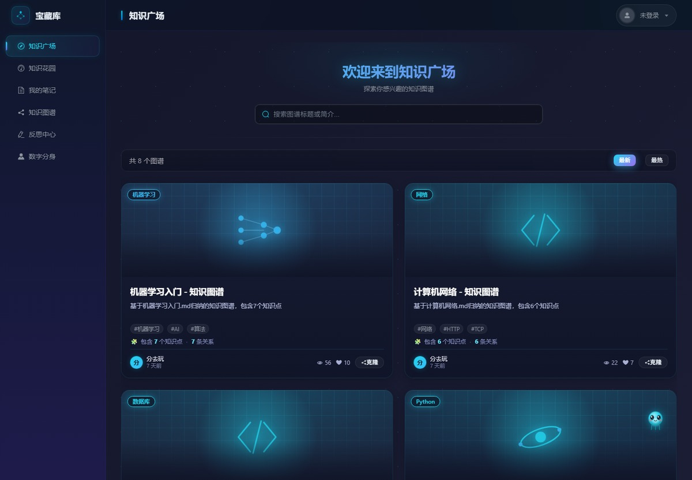
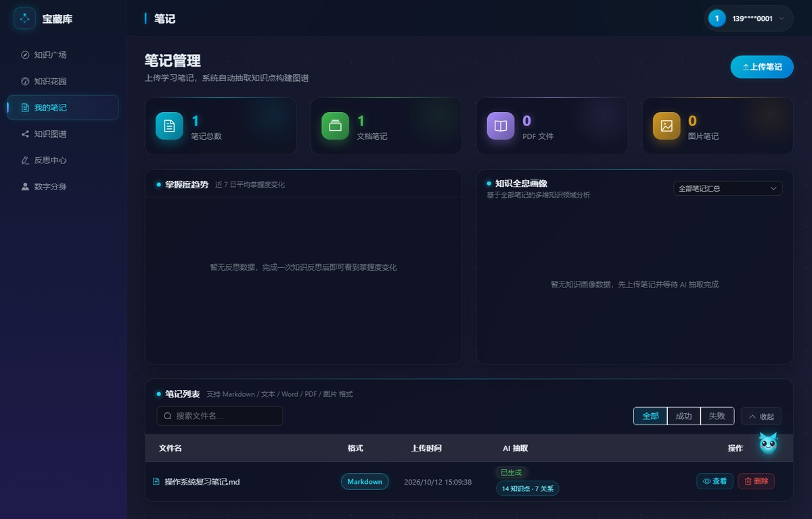
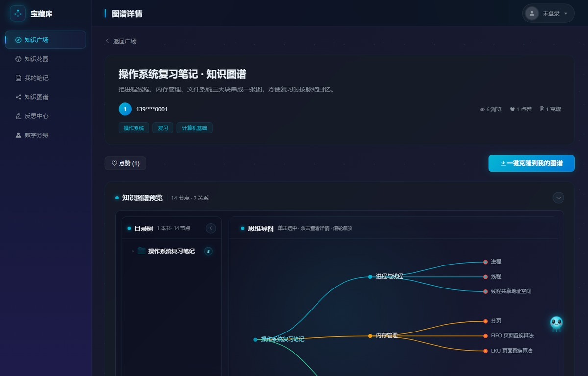
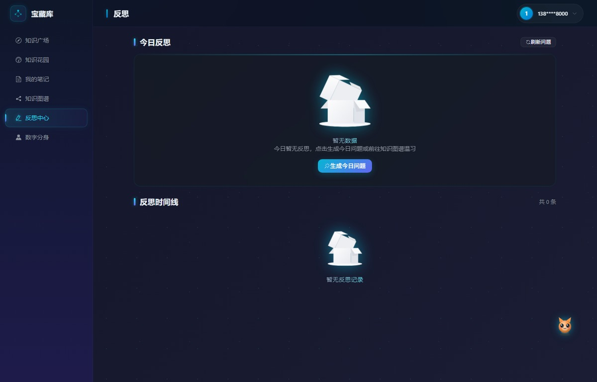
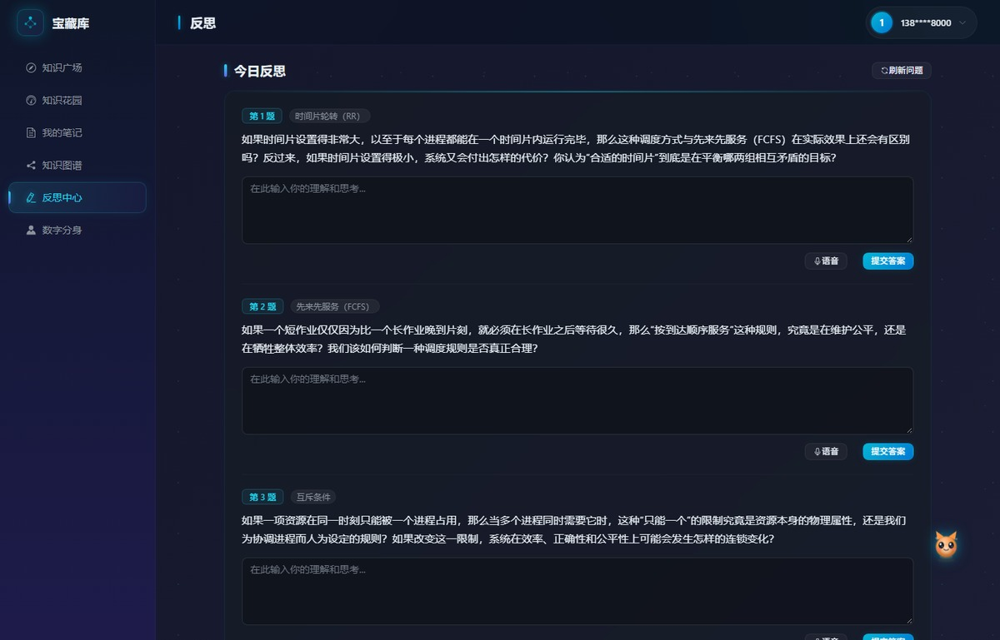
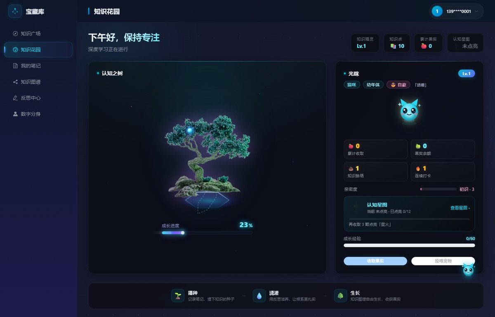
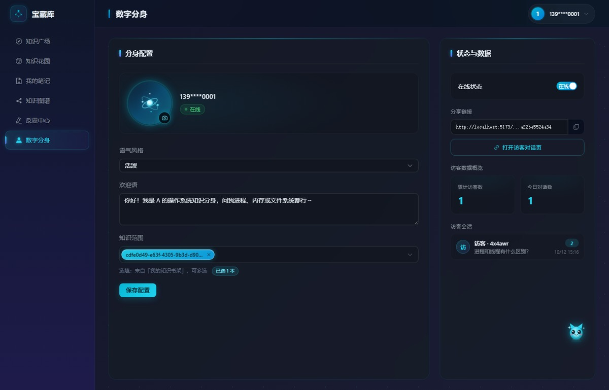
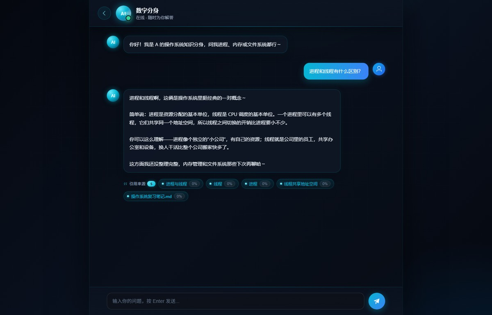
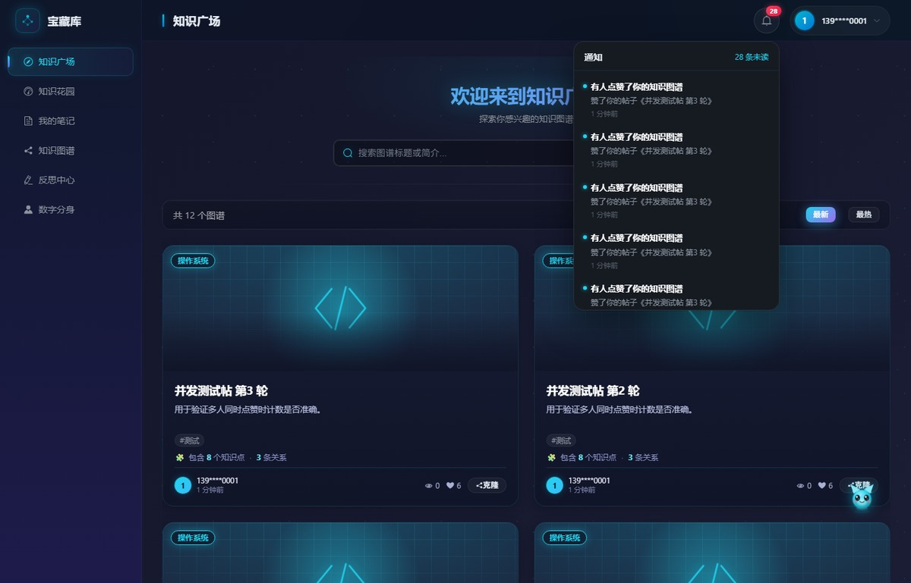

# 大学生知识管理与反思平台

> 将碎片笔记转化为结构化知识图谱，通过 AI 主动提问引导反思，并将个人知识体系发布为可对话的 AI 数字分身。

## 参赛信息

| 项目 | 内容 |
|------|------|
| 作品名称 | 大学生知识管理与反思平台（宝藏库 KRP，Knowledge Reflection Platform） |
| 参赛学生 | 何春 |
| 队伍名称 | 创与闯 |
| 版本号 | v0.1.0 |
| 联系方式 | 19840470251 |
| 开发工具 | 华为云码道（CodeArts Doer） |

### 相关链接

| 链接 | 地址 |
|------|------|
| 代码仓库 | https://gitcode.com/jbvhuhv/knowledge-reflection-platform |
| 作品展览馆发布链接 | `https://gallery.developer.huaweicloud.com/gallery/____________________` ← **待填写：在华为云开发者作品展览馆发布后替换** |

> 提交提示：初赛期间每支队伍可多次迭代优化，最终成绩取截止前**历史最高提交版本**；提交完成后可在平台查看提交状态与初步审核结果。因此建议每次迭代后都重新提交一次。

## 项目简介

本平台面向大学生，提供"笔记 → 知识图谱 → AI 反思 → 数字分身"的知识闭环管理能力：

1. **笔记上传与知识图谱生成** — 上传 Markdown/PDF/Word/TXT/图片笔记，AI 自动抽取知识点与关系，生成可视化知识图谱（图片经多模态模型 OCR 识别后汇入同一抽取链路）
2. **AI 定时主动提问反思** — 基于知识图谱与间隔重复策略，定时生成反思问题，评估掌握度
3. **AI 数字分身发布** — 将个人知识图谱发布为可对话的 AI 角色，访客可基于其知识库提问

## 界面展示

> 以下均为本地实际运行界面的真实截图（无设计稿、无合成图）。

**知识广场：公开知识图谱社区，未登录即可浏览、搜索与克隆**



**我的笔记：支持 Markdown / Word / PDF / TXT / 图片，AI 自动抽取知识点与关系**



**知识图谱：书本 → 目录 → 知识点三级结构，目录树与思维导图双栏联动**

![知识图谱（base64 内联测试）]()

**图谱详情：节点以颜色区分分支、以光环与尺寸编码掌握度**



**反思中心：依据知识点与复习间隔自动生成思辨性问题**



**作答与评分：支持文字/语音作答，AI 从概念准确性、逻辑完整性、举例合理性三维评分**



**知识花园：认知之树随知识输入生长，宠物养成、连续打卡与六维雷达画像**



**数字分身：把个人知识库发布为可对外对话的 AI 角色**



**分身对话：访客免登录提问，回答附引用来源，超出知识范围会明确拒答**



**通知中心：点赞、评论、克隆实时通知作者**



## 演示视频

**功能演示视频（2 分 47 秒，中文配音解说）**：[`docs/demo/demo-video.mp4`](docs/demo/demo-video.mp4)

内容：未登录浏览广场 → 手机号验证码登录 → 笔记上传与 AI 抽取 → 翻开知识书查看图谱 → 反思作答与三维评分 → 知识花园与六维画像 → 数字分身访客对话（附引用来源）→ 通知中心。

> 解说词全文（含逐段时轴）：见参赛材料《功能演示视频-解说词.docx》。
## 技术栈

| 层级 | 技术 | 说明 |
|------|------|------|
| 前端 | Vue3 + Vite + Pinia + Element Plus + ECharts + Axios | 组合式 API，图谱可视化，WebSocket 流式对话，深蓝科技风毛玻璃 UI |
| 后端 | FastAPI + uvicorn | 异步高性能，自动 OpenAPI 文档 |
| 图数据库 | Neo4j 5.x | 知识图谱存储与关系查询（不可用时优雅降级） |
| 关系数据库 | SQLite（开发）/ PostgreSQL 16（生产） | 用户、笔记、反思记录、社区帖子等结构化数据 |
| 缓存 | Redis 7 | 验证码限流等缓存（可选；未配置时 `/auth/send-code` 返回 503，`DEBUG=true` 时可用万能码 `123456` 于 `/auth/login` 旁路登录） |
| 异步任务 | FastAPI BackgroundTasks | 知识抽取等后台任务（进程内执行，非独立队列） |
| AI 服务 | MaaS（华为云模型即服务） | LLM 知识抽取、问题生成、分身对话、Embedding |
| 图片识别 | 多模态视觉模型（OpenAI 兼容，OCR_* 配置） | 图片笔记识别为文本后汇入知识抽取链路 |
| 向量存储 | Neo4j 5.x 原生向量索引 | 知识点 Embedding 与相似度检索（RAG） |
| 容器化 | Docker Compose（可选 / 生产参考） | 本地开发无需 Docker：默认 SQLite + 本地 Neo4j |

## 项目结构

```
demo1/
├── README.md                              # 本文件
├── LICENSE                                # MIT License（版权人：KRP Team）
├── CHANGELOG.md                           # 版本变更记录
├── .editorconfig                          # 编辑器编码/换行/缩进统一规范
├── .gitignore                             # 忽略 .env/*.db/*.log/uploads/dist 等
├── docker-compose.yml                     # 容器编排（可选/生产参考）：Neo4j + PostgreSQL + Redis + Backend
├── scripts/                               # 本地脚本（setup.bat / run_backend.bat / ci.bat）
├── deps/                                  # 第三方运行时依赖（JDK / Maven / Neo4j，本地，已排除版本控制）
├── logs/                                  # 运行时日志（后端 / 前端输出）
├── docs/                                  # 全部项目文档（按阅读顺序编号）
│   ├── 00-作品说明与场景亮点.md           # 场景背景/功能架构/核心亮点/环境依赖/码道应用
│   ├── 01-需求规格说明书.md               # 需求规格（21 个 User Story + 验收标准 + 交互原型 + 里程碑）
│   ├── 02-高层架构与系统设计.md           # 架构图/模块划分/技术选型/数据流/RAG 与调度算法/部署
│   ├── 03-前端设计规范.md                 # 前端设计规范（Token/布局/组件/页面）
│   ├── 04-项目结构与目录架构.md           # 目录组织/文件架构/模块职责/依赖方向
│   ├── 05-对话交接.md                     # 对话/开发交接记录
│   ├── 06-CONTRIBUTING.md                 # 贡献指南（环境准备/代码规范/提交规范）
│   ├── 07-DEBUG.md                        # 故障排查（Neo4j/MaaS/跨域/WS 与 SSE）
│   ├── 08-PROMPTS.md                      # Prompt 集中治理说明
│   └── 09-路演文稿.md                     # 项目推介 / 融资路演文稿
├── backend/                               # FastAPI 后端
│   ├── app/
│   │   ├── main.py                        # 应用入口 + lifespan + /health
│   │   ├── scheduler.py                   # APScheduler 每日反思定时任务
│   │   ├── core/                          # 基础设施（config / database / security / logger / exceptions / middleware / prompt_manager / schema_migrations / constants）
│   │   ├── api/
│   │   │   ├── deps/                      # 依赖注入（按业务域拆分，__init__ 全量再导出）
│   │   │   │   ├── auth_deps.py           # 认证依赖（当前用户 / 可选用户）
│   │   │   │   ├── ai_deps.py             # AI 服务工厂
│   │   │   │   ├── graph_deps.py          # 图谱服务
│   │   │   │   ├── notes_deps.py          # 知识抽取服务
│   │   │   │   ├── reflection_deps.py     # 反思服务
│   │   │   │   ├── avatar_deps.py         # 数字分身服务
│   │   │   │   └── notification_deps.py   # 通知服务
│   │   │   └── v1/
│   │   │       ├── router.py              # 路由聚合（统一前缀 /api/v1）
│   │   │       └── endpoints/             # 8 个业务域端点
│   │   │           ├── auth.py            # 认证：发送验证码/登录/me
│   │   │           ├── notes.py           # 笔记：上传/列表/详情/删除
│   │   │           ├── graph.py           # 图谱：节点CRUD/边/来源/subject-stats
│   │   │           ├── reflection.py      # 反思：问题/作答/历史/调度
│   │   │           ├── avatar.py          # 分身：发布/配置/统计/对话WS
│   │   │           ├── community.py       # 社区：发布/列表/详情/点赞/克隆
│   │   │           ├── notifications.py   # 通知：列表/已读
│   │   │           └── pet.py             # 宠物：状态/音色/收割/投喂/流式对话
│   │   ├── models/                        # SQLAlchemy ORM（User, Note, Reflection*, Avatar, ChatMessage, Notification, CommunityPost, CommunityComment, CommunityLike, Pet）
│   │   ├── schemas/                       # Pydantic 请求/响应模型
│   │   └── services/                      # 业务逻辑
│   │       ├── providers/                 # LLM Provider 抽象层（base / maas / openai / vision + 工厂）
│   │       ├── ai/                        # AI 服务实现（base + 5 个场景 Mixin）
│   │       │   ├── base.py                # AIServiceBase + LLM/Embedding provider 工厂
│   │       │   ├── extraction_ai.py       # 知识抽取
│   │       │   ├── quiz_ai.py             # 反思出题
│   │       │   ├── scoring_ai.py          # 答案评分
│   │       │   ├── avatar_ai.py           # 分身对话
│   │       │   └── pet_ai.py              # 宠物流式对话
│   │       ├── ai_service.py              # 兼容 shim（转发 services/ai/）
│   │       ├── file_parser.py             # 文件解析（text/pdf/docx）
│   │       ├── ocr_service.py             # 图片笔记 OCR（多模态模型识别为文本）
│   │       ├── extraction_service.py      # 异步知识抽取（日志 + 重试）
│   │       ├── graph/                     # Neo4j 图谱实现
│   │       │   ├── constants.py           # 节点/关系标签常量
│   │       │   ├── crud.py                # 节点/边 CRUD
│   │       │   ├── tree.py                # 三级树构建
│   │       │   ├── vector.py              # 向量索引与检索
│   │       │   └── stats.py               # 学科统计
│   │       ├── graph_service.py           # 兼容 shim（转发 services/graph/）
│   │       ├── reflection_service.py      # 艾宾浩斯调度+问题生成+评分
│   │       ├── avatar_service.py          # 知识画像+发布+RAG防幻觉对话
│   │       ├── pet_service.py             # 宠物成长数学/情感状态机/对话记忆/主动关怀
│   │       └── notification_service.py    # 站内信创建/列表/已读
│   ├── tests/                             # pytest 测试（234 通过，5 个已知 xfail）
│   │   ├── conftest.py                    # 测试 fixtures
│   │   ├── test_auth.py                   # 认证测试
│   │   ├── test_notes_upload.py           # 上传测试（含图片 OCR/重新抽取）
│   │   ├── test_extraction.py             # 抽取测试（含重试）
│   │   ├── test_ocr_service.py            # 图片 OCR 服务测试
│   │   ├── test_graph.py                  # 图谱测试
│   │   ├── test_reflection.py             # 反思测试
│   │   ├── test_avatar.py                 # 分身测试
│   │   ├── test_avatar_ws.py              # 分身 WebSocket 流式对话测试
│   │   ├── test_community.py              # 社区测试（帖子/列表/详情/点赞/克隆）
│   │   ├── test_notifications.py          # 站内信测试
│   │   ├── test_pet.py                    # 宠物测试（身份/成长数学/收取溢出/情感/关怀）
│   │   └── test_scheduler.py              # 定时任务测试
│   ├── requirements.txt
│   ├── Dockerfile
│   ├── pytest.ini
│   └── .env.example
└── frontend/                              # Vue3 前端
    ├── package.json                       # 依赖：vue, pinia, element-plus, echarts, axios
    ├── vite.config.js                     # Vite 配置 + API 代理 + vite-imagetools
    ├── index.html
    └── src/
        ├── main.js                        # 按需注册 Element Plus 组件/图标 + Pinia + Router（unplugin 自动引入）
        ├── App.vue                        # 根组件
        ├── api/
        │   ├── request.js                 # Axios 实例 + JWT 拦截器
        │   ├── index.js                   # 聚合导出（re-export 各业务域 API）
        │   ├── auth.js                    # 认证 API
        │   ├── notes.js                   # 笔记 API
        │   ├── graph.js                   # 图谱 API
        │   ├── reflection.js              # 反思 API
        │   ├── avatar.js                  # 数字分身 API
        │   ├── community.js               # 社区 API
        │   └── pet.js                     # 宠物 API
        ├── router/index.js                # 路由表（含兜底重定向；无路由守卫）
        ├── stores/                        # Pinia（user.js 登录态 / demo.js 演示模式）
        ├── layouts/MainLayout.vue         # 主布局（220px 深蓝侧边栏 + 毛玻璃顶栏）
        ├── components/                    # LoginModal / PetFloat / PetAvatar / HoloTrophyIcon
        ├── styles/main.css                # 全局深蓝科技风样式 + Element Plus 暗色覆盖
        ├── utils/                         # logger.js / format.js / petStage.js / echarts.js
        └── views/                         # 按业务域分子目录
            ├── dashboard/Dashboard.vue    # 知识花园（动态问候语+宠物家园：认知之树与宠物状态）
            ├── notes/                     # Notes.vue / NoteCategory.vue
            ├── graph/                     # GraphViewer.vue / BookDetail.vue / components/（3 个弹窗）
            ├── reflection/Reflection.vue  # 反思（单列卡片流+雷达图+语音+时间线）
            ├── avatar/                    # Avatar.vue / VisitorChat.vue
            └── community/                 # Community.vue / CommunityDetail.vue / SearchResults.vue
```

## 快速开始

### 1. 环境要求

- Python 3.12+
- Docker & Docker Compose（可选；本地开发无需 Docker，关系库默认 SQLite，Neo4j 可本地启动）
- Node.js 18+（前端）

### 2. 启动基础设施

本地开发**默认无需 Docker**：关系库自动使用 SQLite（`backend/krp.db`），仅需一个 Neo4j（可用下方 `deps/` 本地启动或 Docker）。若需完整容器化栈（Neo4j + PostgreSQL + Redis + Backend），可用 Docker Compose：

```bash
docker-compose up -d
```

启动后服务端口：

| 服务 | 端口 | 说明 |
|------|------|------|
| Backend (FastAPI) | 8000 | API 服务 |
| PostgreSQL | 5432 | 关系数据库 |
| Neo4j Browser | 7474 | 图数据库 Web 界面 |
| Neo4j Bolt | 7687 | 图数据库协议端口 |
| Redis | 6379 | 缓存 |

> **本地开发（无 Docker）：** 关系库使用 SQLite（无需启动）；Redis 可选，未配置时 `/auth/send-code` 返回 503（`DEBUG=true` 下 `123456` 万能码可经 `/auth/login` 旁路）。Neo4j 可用 Docker 单独启动或 `deps/` 本地启动：
>
> ```bash
> docker-compose up -d neo4j
> ```
>
> Bolt `7687` / HTTP `7474`（`NEO4J_URI=bolt://localhost:7687`，用户 `neo4j` / 密码 `krp123456`）。
>
> 提示：`deps/` 目录仅供本项目开发机使用（内含本地 JDK / Maven / Neo4j 构建产物），已从版本控制中排除，开源使用者无需关心。

### 3. 本地开发（后端）

```bash
cd backend
cp .env.example .env          # 编辑配置，填入 MAAS_API_KEY 等
D:\Python313\python.exe -m pip install -r requirements.txt
D:\Python313\python.exe -m uvicorn app.main:app --reload --host 0.0.0.0 --port 8000
```

> Windows 本地开发请使用 `D:\Python313\python.exe`（`python` 可能是 Microsoft Store 占位程序）。

访问 `http://localhost:8000/docs` 查看 OpenAPI 交互文档。

### 4. 运行测试

```bash
cd backend
D:\Python313\python.exe -m pytest -v
```

或在项目根目录运行一键 CI（后端测试 + 前端构建）：

```bash
scripts\ci.bat
```

### 5. 本地开发（前端）

```bash
cd frontend
npm install
npm run dev
```

访问 `http://localhost:5173`，Vite 代理 `/api` 到后端 `http://localhost:8000`。

访客对话页地址：`http://localhost:5173/chat/{avatarId}`（无需登录）。

## API 接口概览

### 已实现

| 方法 | 路径 | 说明 |
|------|------|------|
| POST | `/api/v1/auth/send-code` | 发送短信验证码（限流：60s/次，5次/天） |
| POST | `/api/v1/auth/login` | 手机号+验证码登录（未注册自动创建），返回 JWT Token |
| GET | `/api/v1/auth/me` | 获取当前登录用户信息 |
| POST | `/api/v1/notes/upload` | 上传笔记（含图片，图片经多模态模型 OCR 识别），返回笔记 ID + 任务 ID，异步触发知识抽取 |
| GET | `/api/v1/notes` | 当前用户笔记列表 |
| GET | `/api/v1/notes/{noteId}` | 笔记详情 |
| DELETE | `/api/v1/notes/{noteId}` | 删除笔记 |
| POST | `/api/v1/notes/{noteId}/re-extract` | 对抽取失败/为空的笔记重新抽取（重置为 pending） |
| GET | `/api/v1/graph/books` | 获取知识书列表（书架视图数据源） |
| GET | `/api/v1/graph/tree/{bookId}` | 获取指定知识书的三级树（目录 + 知识点） |
| GET | `/api/v1/graph/{userId}` | 获取知识图谱（支持学科过滤） |
| GET | `/api/v1/graph/subject-stats` | 学科维度知识统计（知识画像雷达图数据源） |
| POST | `/api/v1/graph/nodes` | 手动创建知识节点（书本） |
| POST | `/api/v1/graph/categories` | 手动创建目录节点 |
| POST | `/api/v1/graph/knowledge` | 手动创建知识点节点 |
| PUT | `/api/v1/graph/nodes/{nodeId}` | 更新节点信息 |
| DELETE | `/api/v1/graph/nodes/{nodeId}` | 删除节点（及关联边） |
| POST | `/api/v1/graph/edges` | 创建节点间关系 |
| GET | `/api/v1/graph/nodes/{nodeId}/source` | 查看节点来源笔记 |
| POST | `/api/v1/graph/nodes/{nodeId}/ai-summary` | 为节点生成 AI 摘要 |
| GET | `/api/v1/reflection/today` | 获取今日反思问题（无则自动生成） |
| POST | `/api/v1/reflection/answer` | 提交作答并获取 AI 评估反馈 |
| GET | `/api/v1/reflection/history` | 查看反思历史记录（分页） |
| GET | `/api/v1/reflection/mastery` | 查看掌握度趋势 |
| GET | `/api/v1/reflection/schedule` | 获取反思调度设置 |
| PUT | `/api/v1/reflection/schedule` | 更新反思频率与时间段 |
| POST | `/api/v1/avatar/avatar-image` | 上传分身头像 |
| POST | `/api/v1/avatar/publish` | 发布数字分身，生成唯一分享链接 |
| POST | `/api/v1/avatar/unpublish` | 下线分身，停止可对话 |
| PUT | `/api/v1/avatar/config` | 配置对话风格/欢迎语/知识范围 |
| GET | `/api/v1/avatar/me` | 获取当前用户分身信息 |
| GET | `/api/v1/avatar/{avatarId}` | 访客获取已上线分身公开信息 |
| GET | `/api/v1/avatar/{avatarId}/stats` | 对话统计与高频提问 |
| GET | `/api/v1/avatar/{avatarId}/conversations` | 访客会话列表（会话聚合） |
| GET | `/api/v1/avatar/{avatarId}/conversations/{visitorId}` | 指定访客的对话明细 |
| WS | `/api/v1/avatar/chat/{avatarId}` | 访客与分身流式对话（含来源标注） |
| GET | `/api/v1/notifications` | 获取站内通知列表（含未读数） |
| PUT | `/api/v1/notifications/{notificationId}/read` | 标记通知已读 |
| GET | `/api/v1/community/posts` | 知识广场公开图谱列表（分页/标签过滤/排序，无需登录） |
| GET | `/api/v1/community/my-posts` | 当前用户发布的帖子列表 |
| GET | `/api/v1/community/posts/{postId}` | 图谱详情（浏览量+1，无需登录） |
| POST | `/api/v1/community/posts` | 发布个人图谱到广场（需登录） |
| POST | `/api/v1/community/posts/{postId}/visibility` | 切换帖子公开/撤回 |
| DELETE | `/api/v1/community/posts/{postId}` | 删除帖子 |
| GET | `/api/v1/community/posts/{postId}/comments` | 帖子评论列表 |
| POST | `/api/v1/community/posts/{postId}/comments` | 发表评论 |
| DELETE | `/api/v1/community/comments/{commentId}` | 删除评论 |
| POST | `/api/v1/community/cover` | 上传帖子封面 |
| POST | `/api/v1/community/posts/{postId}/like` | 点赞/取消点赞（需登录，幂等） |
| POST | `/api/v1/community/posts/{postId}/fork` | 一键克隆图谱到个人知识库（需登录，新节点 mastery=0） |
| GET | `/api/v1/pet/status` | 获取宠物与认知之树状态 |
| POST | `/api/v1/pet/voice` | 保存宠物音色预设（账号级） |
| POST | `/api/v1/pet/harvest` | 收获认知之树果实 |
| POST | `/api/v1/pet/feed` | 投喂宠物 |
| POST | `/api/v1/pet/chat` | 与宠物流式对话（SSE） |
| GET | `/health` | 健康检查 |

### 骨架待实现

无遗留骨架，后端全部实现。

## 配置说明

复制 `backend/.env.example` 为 `backend/.env`，关键配置项：

| 配置 | 说明 | 默认值 |
|------|------|--------|
| `MAAS_API_KEY` | MaaS 大模型 API Key | （需填入） |
| `MAAS_BASE_URL` | MaaS 服务地址 | （需填入） |
| `MAAS_MODEL` | LLM 模型名称 | pangu |
| `MAAS_EMBEDDING_MODEL` | Embedding 模型名称 | bge-m3 |
| `OCR_API_KEY` | 图片识别多模态模型 API Key（不填则图片笔记不可用） | （可选） |
| `OCR_BASE_URL` | 图片识别服务地址（OpenAI 兼容） | （可选） |
| `OCR_MODEL` | 图片识别多模态模型名称 | （可选） |
| `EMBEDDING_DIMENSION` | 向量维度（需与模型一致） | 1024 |
| `AVATAR_SIMILARITY_THRESHOLD` | RAG 相似度阈值，低于则拒答 | 0.7 |
| `AVATAR_TOP_K` | RAG 检索返回条数 | 5 |
| `SHARE_BASE_URL` | 分身分享链接前端基址 | http://localhost:5173 |
| `UPLOAD_DIR` | 笔记文件存储目录 | ./uploads |
| `MAX_FILE_SIZE` | 最大文件大小（字节） | 10485760 (10MB) |
| `NEO4J_URI` | Neo4j 连接地址 | bolt://localhost:7687 |
| `SECRET_KEY` | JWT 签名密钥 | （生产环境必须修改） |

## 开发路线图

| 阶段 | 内容 | 状态 |
|------|------|------|
| M1 基础架构 | 脚手架 + 数据库 + 认证模块 | ✅ 完成 |
| M2 笔记与知识图谱 | 上传 + 知识抽取 + Neo4j 建图 + 图谱CRUD | ✅ 完成 |
| M3 AI 反思引擎 | 提问生成 + APScheduler 定时调度 + 掌握度评估 + 站内通知 | ✅ 完成 |
| M4 数字分身 | Neo4j向量索引 + RAG防幻觉 + 分身对话 | ✅ 完成 |
| M5 前端 | Vue3 全部页面 | ✅ 完成 |
| M6 优化与上线 | 深蓝科技风视觉重构 + 社区模块 + 性能/安全/测试/部署 | 🔄 进行中（视觉重构+社区+安全加固+性能瘦身+响应式+CI 已完成） |

## 相关文档

- [作品说明与场景亮点](docs/00-作品说明与场景亮点.md) — 场景背景、功能架构、核心亮点、环境依赖与码道应用
- [需求规格说明书](docs/01-需求规格说明书.md) — 21 个 User Story + 验收标准 + 交互原型 + 里程碑
- [高层架构与系统设计](docs/02-高层架构与系统设计.md) — 架构图、模块划分、技术选型、数据流、RAG/调度算法与部署
- [前端设计规范](docs/03-前端设计规范.md) — 设计 Token、全局布局、组件规范、页面设计
- [项目结构与目录架构](docs/04-项目结构与目录架构.md) — 目录组织、文件架构与模块职责
- [对话交接文档](docs/05-对话交接.md) — 当前进度与后续交接
- [贡献指南](docs/06-CONTRIBUTING.md) — 环境准备、代码规范、提交规范
- [调试排查](docs/07-DEBUG.md) — Neo4j / MaaS / 跨域 / WS 与 SSE 排查路径
- [Prompt 治理](docs/08-PROMPTS.md) — Prompt 集中管理与防注入约定
- [路演文稿](docs/09-路演文稿.md) — 项目推介 / 融资路演文稿